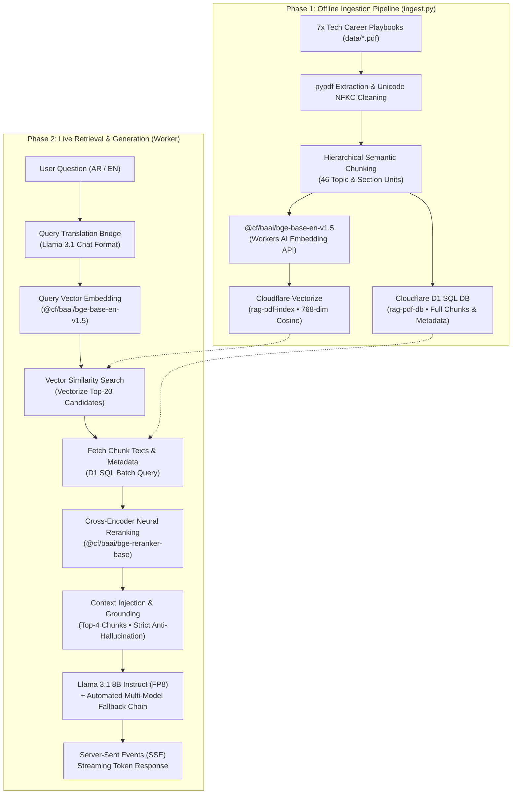

# Masar AI — RAG Architecture & Cloudflare Pipeline Documentation

> **Core Focus**: This document exclusively covers the **Retrieval-Augmented Generation (RAG) Architecture** and the **Cloudflare Serverless AI Infrastructure**. It details the ingestion pipeline, semantic chunking, vector indexing, neural reranking, and LLM orchestration.

---

## 1. High-Level System Architecture



---

## 2. Infrastructure & Cloudflare Services Matrix

| Component | Cloudflare Service | Model / Resource ID | Primary Role |
| :--- | :--- | :--- | :--- |
| **Embeddings** | Cloudflare Workers AI | `@cf/baai/bge-base-en-v1.5` | Converts text passages and queries into 768-dimensional dense vectors. |
| **Vector Store** | Cloudflare Vectorize | `rag-pdf-index` | Performs sub-millisecond Cosine Similarity nearest-neighbor search. |
| **Relational Store** | Cloudflare D1 | `rag-pdf-db` (`8093e5a3-...`) | Serverless SQLite database storing original chunk text, document name, section, and page number. |
| **Neural Reranker**| Cloudflare Workers AI | `@cf/baai/bge-reranker-base` | Cross-encoder that re-scores top candidates, filtering irrelevant context and scoring up to **99.7%** relevance. |
| **Primary LLM** | Cloudflare Workers AI | `@cf/meta/llama-3.1-8b-instruct-fp8` | Generates fluent, strictly grounded answers with citations. Uses FP8 quantization for ultra-low neuron consumption. |
| **LLM Fallback 1**| Cloudflare Workers AI | `@cf/meta/llama-3.3-70b-instruct-fp8-fast`| High-intelligence 70B parameter fallback if the primary model is throttled. |
| **LLM Fallback 2**| Cloudflare Workers AI | `@cf/meta/llama-3.2-3b-instruct` | High-speed lightweight fallback to prevent pipeline failure. |
| **Execution Engine**| Cloudflare Workers | `rag-pdf-worker` | Edge serverless runtime executing the entire RAG lifecycle globally. |

> [!TIP]
> **Why is it 100% Free?**  
> Cloudflare Workers AI grants **10,000 free Neurons per day** (renewed every 24h). The quantized FP8 models consume fractions of a neuron per token. Vectorize and D1 offer millions of free queries per month, making the entire RAG pipeline operate with zero cost.

---

## 3. Phase 1: Ingestion & Semantic Chunking Engine

The offline ingestion pipeline is located in `ingestion/ingest.py`.

### Why Naive Chunking Failed:
- **Sliding-window / Character chunking** cut texts every ~240 words regardless of sentences or topics.
- **Counter-offer scripts** and the **STAR method framework** were severed in half across page boundaries.
- Adjacent unrelated topics were merged, diluting vector representations and lowering cosine similarity.

### The Semantic Chunking Solution:
1. **Continuous Document Streaming**: Extracts text across pages while keeping an exact line-to-page tracking map (prevents slicing at page boundaries).
2. **Hierarchical Topic Detection**: Matches genuine playbook section headers (`^\d+\.\s+([A-Z].*)`), isolating each core topic as an atomic semantic unit.
3. **Dynamic Boundary Enforcement**:
   - Small sections (under 290 words) like checklists or scripts remain **100% intact as single chunks**.
   - Larger sections are segmented along natural paragraph breaks (`\n\n`), merging micro-paragraphs (<40 words) with adjacent text.
4. **Context Enrichment (Metadata Injection)**:  
   Every chunk text is explicitly prefixed with hierarchical breadcrumbs before embedding:
   ```text
   Document: {Playbook Title} | Section: {Section Title} (Page {Page Range})

   {Chunk Body Text}
   ```
5. **Output**: The 7 playbooks are partitioned into **46 pristine semantic chunks**.

---

## 4. Phase 2: Live Query & Retrieval Engine

Executed in `worker/src/index.js` during every user interaction:

### Step 1: Query Translation & Reformulation Bridge
- If the query is in Arabic, an LLM translation call using the Chat Messages API converts the query into concise English search keywords (e.g., *"ازاي اجهز لمقابلة الـ behavioral وايه هي طريقة الـ STAR؟"* ➡️ `"behavioral interview STAR method preparation"`).
- *Critical Engineering Gotcha*: Using raw completion prompts caused Llama 3 to output conversational chatter (*"Here is your translation:"*). Using the `messages` array with a system role enforces zero-chatter keyword extraction.
- For conversational follow-ups (e.g., *"give me an example of the second point"*), previous turns from `history` are fed to generate a standalone search query.

### Step 2: Dense Vector Retrieval (Vectorize)
- The search query is embedded using `@cf/baai/bge-base-en-v1.5` to generate a 768-dimensional float vector.
- Vectorize performs Cosine Similarity search over the index, retrieving the top `k = 20` nearest candidate chunk IDs in under 15ms.

### Step 3: Text Retrieval (D1)
- The Worker queries Cloudflare D1 via SQL:
  ```sql
  SELECT chunk_id, document, page, text FROM chunks WHERE chunk_id IN (?, ?, ...)
  ```
- This retrieves the full chunk texts and metadata for all candidate IDs.

### Step 4: Cross-Encoder Neural Reranking
- Dense vector search is bi-encoder retrieval (fast but approximate).
- The candidates are passed to `@cf/baai/bge-reranker-base` (a cross-encoder that jointly encodes the query and each chunk text).
- It scores true semantic relevance on a 0 to 1 scale. Chunks with score `< 0.03` are discarded; top `N = 4` chunks are retained.
- **Result**: Relevant chunks consistently score **0.92 to 0.997**.

### Step 5: Grounded Prompt Assembly & Strict Anti-Hallucination
- The top reranked chunks are structured into an authoritative Reference Block:
  ```text
  Career Playbook Reference Material:

  [Source 1: Behavioral Interview Framework, Page 1]
  Document: Behavioral Interview Framework | Section: 1. The STAR Method (Page 1)
  ...
  ---
  User Question: ...
  ```
- The Master System Prompt instructs the model:
  1. Base answers **STRICTLY** on the provided playbook material.
  2. Do not invent details not present in the sources.
  3. Respond 100% in the user's language (pure Arabic on Arabic queries, pure English on English queries).
  4. Always cite playbook titles and page numbers.

### Step 6: Multi-Model Fallback & Token Streaming
- Tries `@cf/meta/llama-3.1-8b-instruct-fp8` first.
- If unavailable or throttled, automatically catches the error and cascades to `@cf/meta/llama-3.3-70b-instruct-fp8-fast`, then `@cf/meta/llama-3.2-3b-instruct`.
- Streams tokens to the client over Server-Sent Events (`text/event-stream`), creating an instant typewriter UX.

---

## 5. Quick Reference & Commands

### How to Re-Index Documents (If you add/modify PDFs):
```powershell
# In the project root:
python ingestion/ingest.py
```
*(Automatically extracts PDFs, chunks semantically, embeds via Workers AI, and updates Vectorize and D1).*

### How to Re-Deploy the Worker:
```powershell
cd worker
npx wrangler deploy
```

### Essential File Map:
- `ingestion/ingest.py`: Offline semantic chunking, embedding generation, Vectorize & D1 loader.
- `worker/src/index.js`: Live RAG worker (query resolution, vector search, reranking, LLM orchestration).
- `worker/wrangler.jsonc`: Cloudflare bindings config (`AI`, `VECTOR_INDEX`, `DB`).
